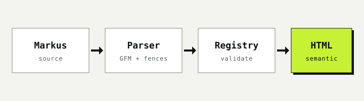

Markus renders CommonMark plus the GFM extensions with markdown-it. Each section shows the Markdown beside what it renders.

## Headings

:::example
```markus
# Heading 1

## Heading 2

### Heading 3

#### Heading 4

##### Heading 5

###### Heading 6
```
:::

## Emphasis, strong, strikethrough, inline code

:::example
```markus
*Italic*, **bold**, ***both***, ~~struck~~, and `inline code`.
```
:::

## Links and autolinks

:::example
```markus
An [inline link](https://github.github.com/gfm/), a [link with a title](https://example.com "Example title"), a [reference link][ref], and a bare URL https://github.com/AnthusAI/Markus that becomes a link.

[ref]: https://example.com
```
:::

## Images

:::example
```markus

```
:::

## Bullet lists, nested

:::example
```markus
- Parse
- Validate
  - Attributes
  - Nesting
- Render
```
:::

## Ordered lists

:::example
```markus
1. Parse
2. Validate
3. Render

Starting elsewhere:

5. Five
6. Six
```
:::

## Task lists

:::example
```markus
- [x] Tables
- [x] Strikethrough
- [ ] Something still to do
```
:::

## Tables with alignment

:::example
```markus
| Left | Center | Right |
| :--- | :---: | ---: |
| a | b | c |
| longer | cell | 12 |
```
:::

## Fenced code with a language

:::example
````markus
```python
from markusmd import convert

html = convert("# Hello\n")
```
````
:::

## Indented code

:::example
```markus
    four spaces
    make a code block
```
:::

## Blockquotes

:::example
```markus
> A quote.
>
> > A nested quote.
```
:::

## GFM alerts

:::example
```markus
> [!NOTE]
> A note alert.

> [!WARNING]
> A warning alert.
```
:::

## Thematic break

:::example
```markus
Above

---

Below
```
:::

## Hard and soft line breaks

:::example
```markus
A soft break
continues the line.

A hard break ends with two spaces  
or a backslash\
and starts a new line.
```
:::

## Typographer

:::example
```markus
"Smart quotes", it's, an ellipsis..., and a dash -- or --- are typeset.
```
:::

## Escapes

:::example
```markus
\*not italic\*, \`not code\`, and \# not a heading.
```
:::

## Raw HTML

Raw HTML is off unless you pass `--allow-html`. This site does not enable it, so an HTML tag in source is shown as text:

<kbd>Ctrl</kbd>
